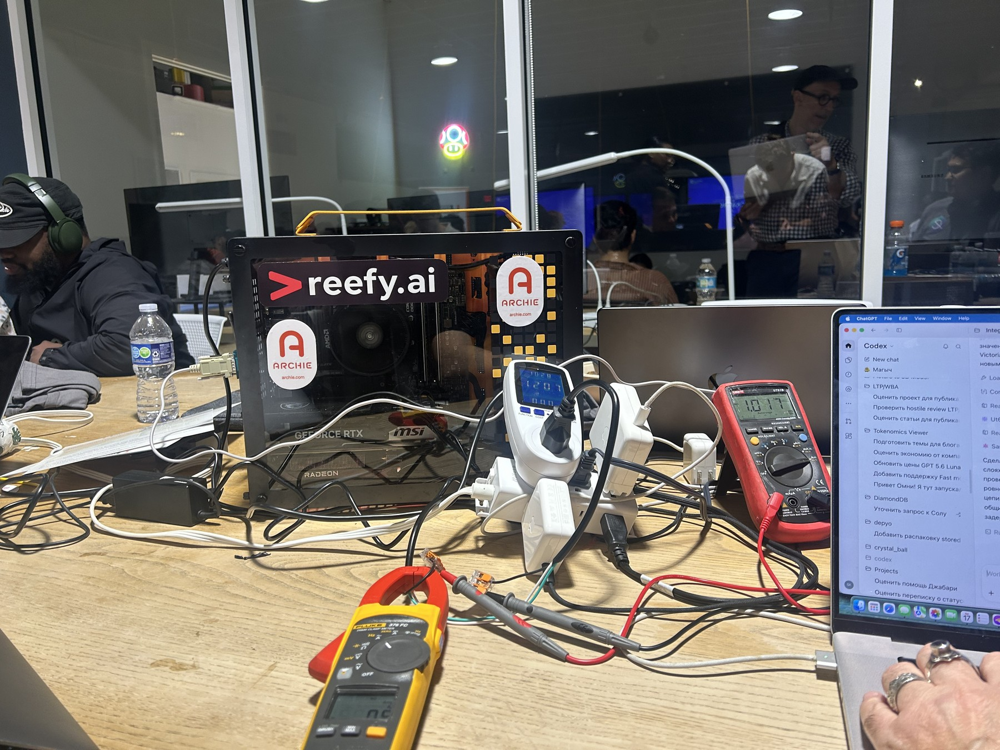
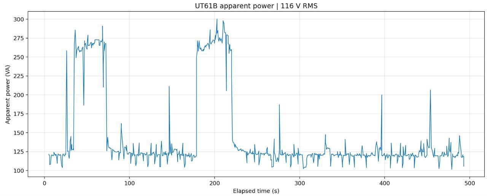
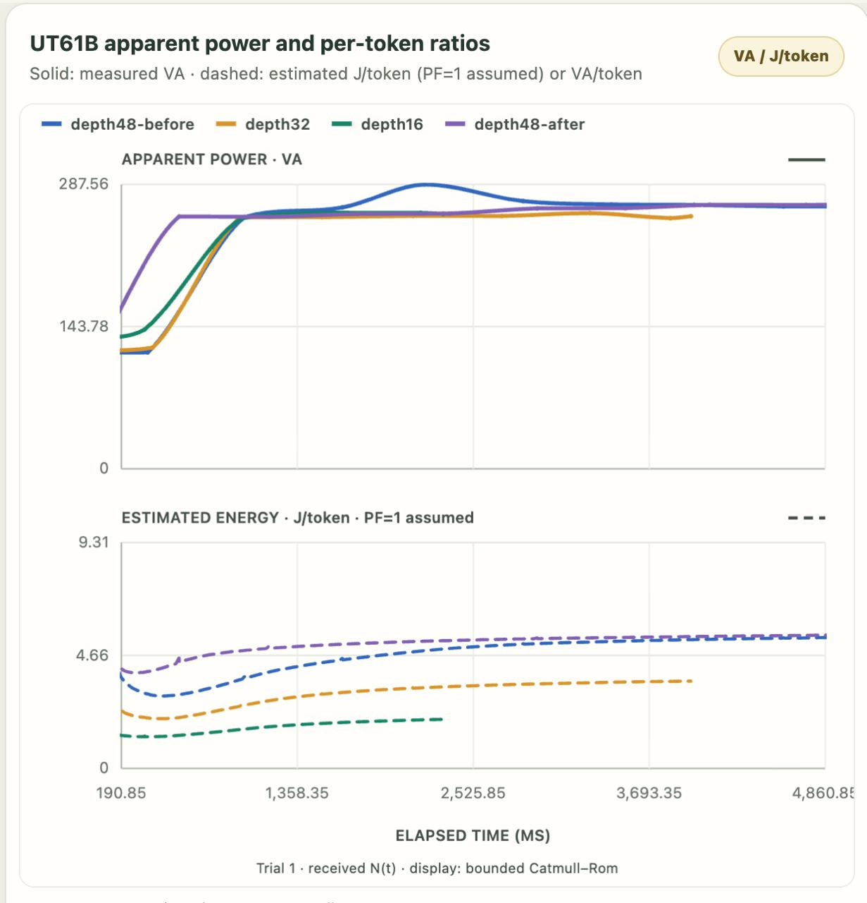
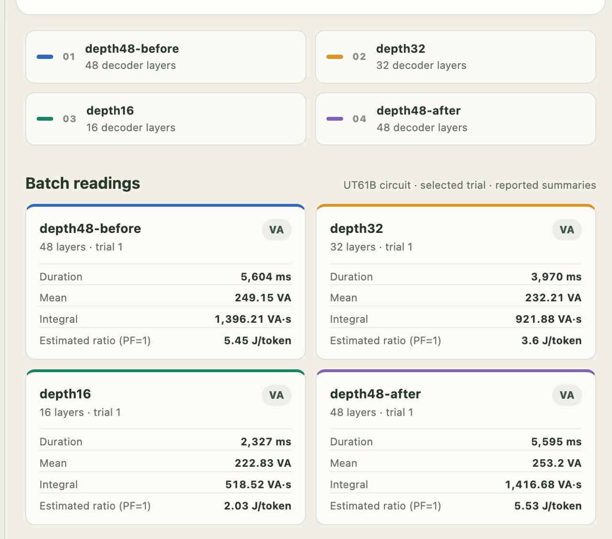

# Measuring Power per LLM token

**Team AC/DC**

At this hackathon, we ran **Gemma 4 locally on a GPU** and recorded electrical load using a **USB-connected measurement tool**. Our open-source project connects electricity use with token output to help data centers with limited power evaluate efficiency.


**[Run the demo](https://maxchamp2005-sudo.github.io/llm-energy-efficiency/#demo)** · **[View the eight-slide pitch](https://maxchamp2005-sudo.github.io/llm-energy-efficiency/#pitch)** · **[Download the deck](docs/hackathon-pitch.pptx)**

## Isolated Enterprise Datacenter

Isolated enterprise data centers process all LLM requests on hardware within their own perimeter, without internet access. Their power budget limits the inference capacity available to users.

For a small-scale demonstration at the hackathon, we used a local workstation with two GPUs: an NVIDIA GeForce RTX 5060 and an AMD Radeon 7900.



*Hackathon workstation used for a small-scale demonstration.*

## Hackathon measurement trace



**Apparent power (VA) at 116 V RMS over elapsed time.** Real power (W) = apparent power (VA) × true power factor. Energy per token needs real watt-hours and matched token counts.

## Decoder-layer comparison

[](docs/decoder-depth-traces.jpg)

Trial 1 compares 16-, 32- and 48-layer configurations, including a repeat 48-layer run. Solid curves show apparent power (VA). Dashed curves show estimated J/token assuming PF = 1.

[](docs/decoder-depth-batch-readings.jpg)

The 16-layer run reports 2.03 J/token under PF = 1, compared with 5.45 J/token for the initial 48-layer run. Run durations differ, and quality results are not shown.

## What we built

Alongside the local Gemma 4 measurement, we built a browser tool for comparing LLM batches. It accepts batch energy and token counts, reports **tokens per kWh** and **Wh per accepted task**, checks quality and response-time limits, and exports a JSON report.

A separate calculator estimates energy from **116 V AC, current, true power factor and run time**.


The browser demo uses **illustrative inputs**, separate from the Gemma 4 measurement: A accepts 96% of tasks at 820 ms p95. B accepts 94% at 1,120 ms. The rules require at least 95% acceptance and p95 at most 1,000 ms.

## Run locally

Download the repository and serve its root with any static web server. With Python installed:

```sh
python3 -m http.server 8000
```

Open http://localhost:8000/. The site includes the demo and pitch; keep the `docs/` assets alongside `index.html`. Readable source is in [`src/`](src/).

To rebuild after editing `src/`, run `python3 build.py` (Python standard library only).

## Measurement scripts

The [measurement toolkit](measurement/) contains the UT61B and NVIDIA collectors,
fixed-token Gemma 4 runner, VictoriaMetrics remote-write/readback, experimental
layer pruning, and standalone trace charts. See its README for setup and tests.
The compact UT61B energy chart explicitly estimates J/token assuming PF=1.

## License and references

Original source code is available under the [MIT license](LICENSE). The project owner supplied the team and workstation photos; third-party references retain their own terms.

[Measurement research and full technical deck](docs/research-deck.pptx).
