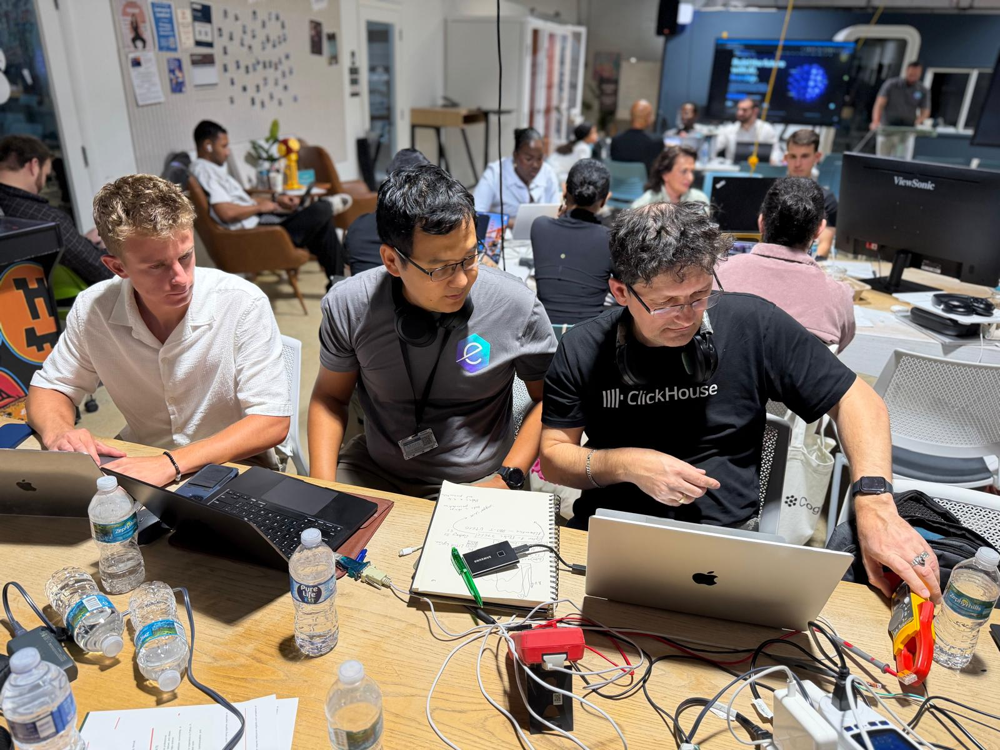
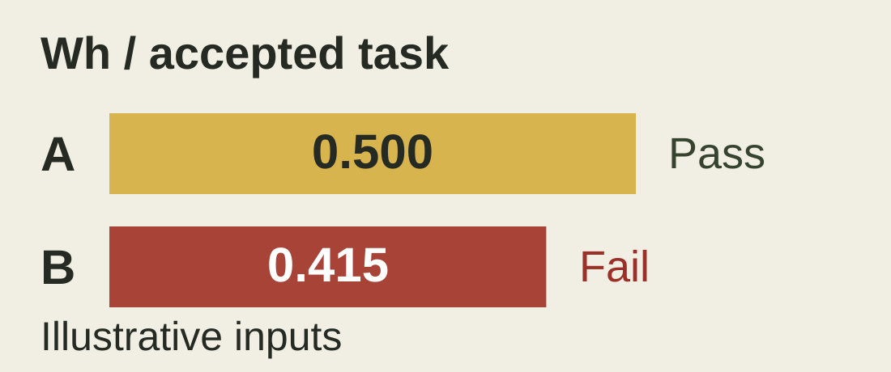

# Measuring electricity per LLM token

**Team AC/DC**

At this hackathon, we built an open-source project to show how electricity becomes LLM tokens and help data centers use limited power more efficiently.



**[Run the demo](https://maxchamp2005-sudo.github.io/llm-energy-efficiency/#demo)** · **[View the five-slide pitch](https://maxchamp2005-sudo.github.io/llm-energy-efficiency/#pitch)** · **[Download the deck](docs/hackathon-pitch.pptx)**

## What we built

A browser tool that compares LLM batches using electricity use and generated tokens. It reports **tokens per kWh** and **Wh per accepted task**, checks the quality and response-time limits, and exports a JSON report. A separate calculator estimates energy from **116 V AC, current, true power factor and run time**.



The example uses **illustrative inputs**: A accepts 96% of tasks at 820 ms p95. B accepts 94% at 1,120 ms. The rules require at least 95% acceptance and p95 at most 1,000 ms. These are demo values, not hardware results.

## Run locally

Download the repository and serve its root with any static web server. With Python installed:

```sh
python3 -m http.server 8000
```

Open http://localhost:8000/. The site includes the demo and pitch; keep the `docs/` assets alongside `index.html`. Readable source is in [`src/`](src/).

To rebuild after editing `src/`, run `python3 build.py` (Python standard library only).

## Next measurement step

Connect real supply W/Wh and task logs over the same test window, then repeat a fixed workload. GPU telemetry provides a separate diagnostic. The current tool uses entered data and does not include a meter or GPU collector.

[Measurement research and full technical deck](docs/research-deck.pptx). Original source code is under the [MIT license](LICENSE). The project owner supplied the team photo; third-party references retain their own terms.
